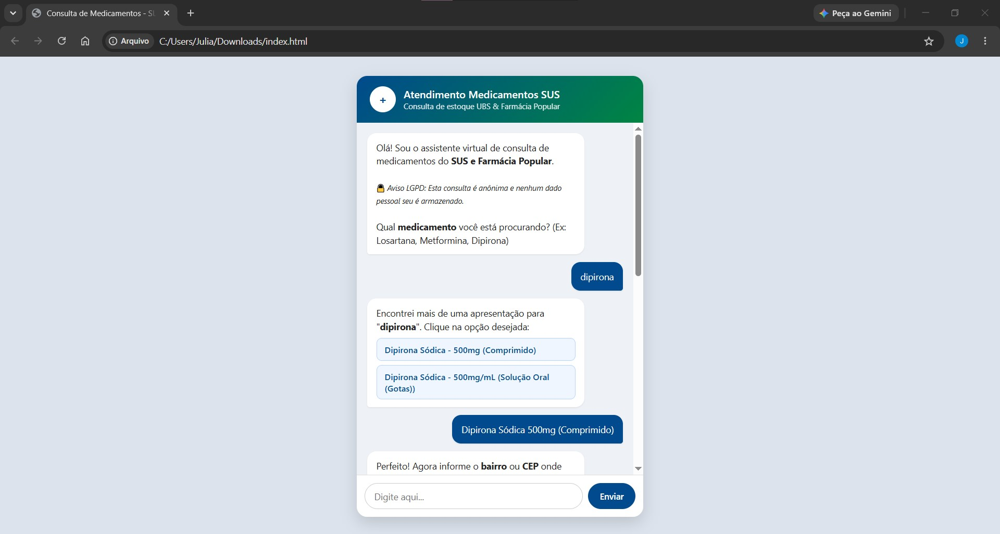
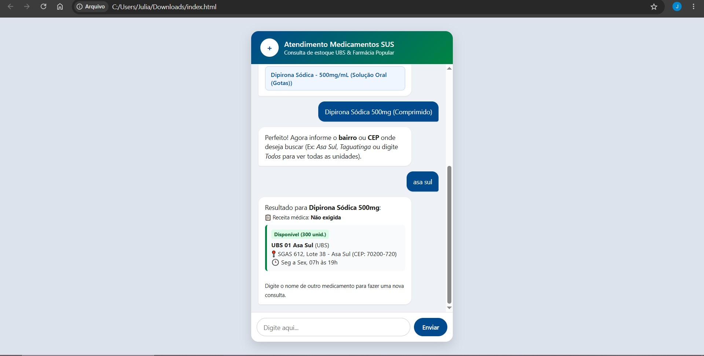
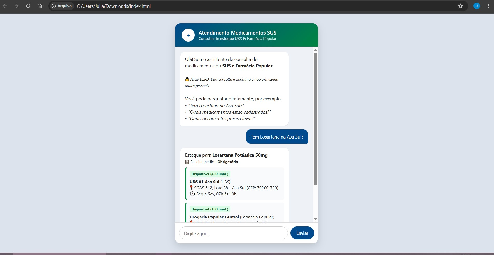
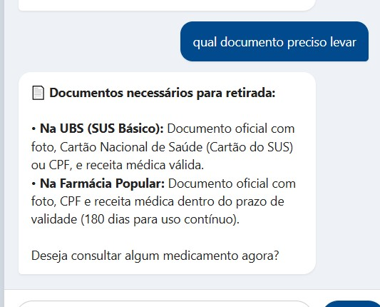
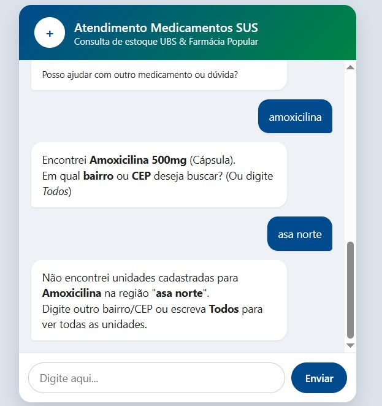

#  Demonstração Visual e Evolução da Interface

Este documento apresenta os registros visuais do **Chatbot SUS**, incluindo cenários de consulta bem-sucedida, orientação documental e tratamento de indisponibilidade.

---

## 1. Fluxos Guiados, Documentação e Tratamento de Falta

Registros dos cenários funcionais validados na interface conversacional, cobrindo desambiguação de medicamentos, exigência de receita médica, dúvidas sobre documentos e tratamento quando não há estoque na região solicitada:

| Aviso LGPD e Desambiguação | Filtro por Bairro e Card da UBS |
| :---: | :---: |
|  |  |
| *Exibição do aviso de anonimato (LGPD) e seleção entre Comprimido ou Solução Oral.* | *Resultado detalhado para Dipirona Sódica 500mg na UBS 01 Asa Sul (300 unidades).* |

| Consulta Direta com Receita Obrigatória | Orientação de Documentos para Retirada |
| :---: | :---: |
|  |  |
| *Busca por Losartana Potássica 50mg na Asa Sul destacando a obrigatoriedade de receita médica.* | *Assistente informando a documentação exigida na UBS (SUS Básico) e na Farmácia Popular.* |

| Tratamento de Indisponibilidade Regional (RF05) |
| :---: |
|  |
| *Busca por Amoxicilina 500mg na Asa Norte sem unidades disponíveis no momento, orientando busca em outro bairro ou com a opção "Todos".* |
