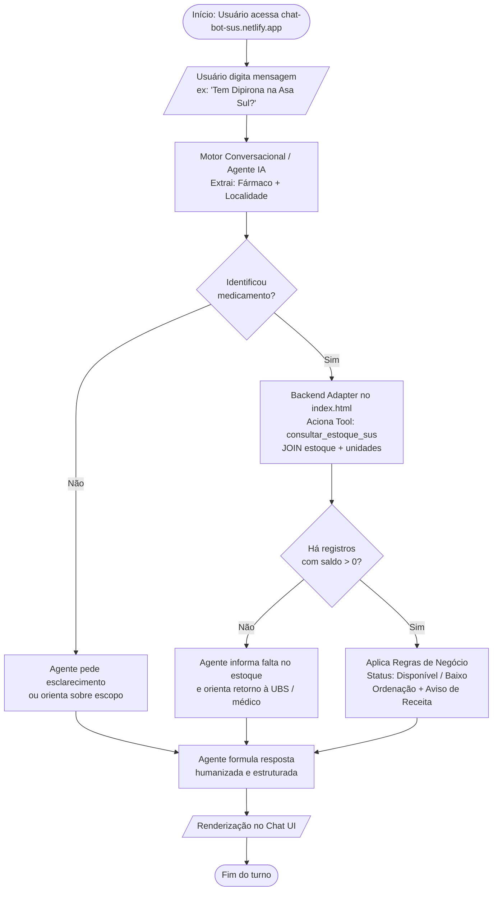
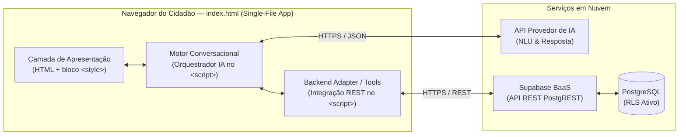
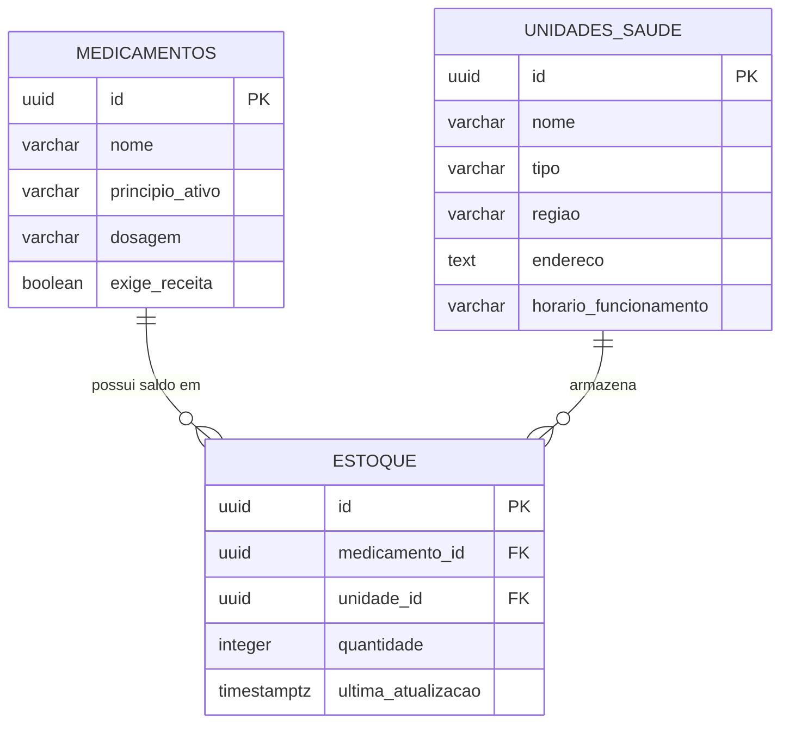

#  Chatbot SUS — Consulta Inteligente de Estoque de Medicamentos

-yellow)


> **Ambiente de Produção (Online):** [https://chat-bot-sus.netlify.app](https://chat-bot-sus.netlify.app)  
> **Classificação do Projeto:** Aplicação Web Responsiva (*Single-File Application*) com Agente de IA Conversacional integrado a API REST/BaaS, voltada para cidadãos usuários do SUS, operadores de dados/suporte, gestores de saúde e desenvolvedores mantenedores.

---

##  Sumário

- [1. Visão Geral e Escopo](#1-visão-geral-e-escopo)
  - [1.1 Objetivo do Sistema](#11-objetivo-do-sistema)
  - [1.2 Escopo e Limites](#12-escopo-e-limites)
  - [1.3 Regras de Negócio](#13-regras-de-negócio)
  - [1.4 Mapeamento de Stakeholders](#14-mapeamento-de-stakeholders)
- [2. Requisitos e Fluxos](#2-requisitos-e-fluxos)
  - [2.1 Requisitos Funcionais (RF)](#21-requisitos-funcionais-rf)
  - [2.2 Requisitos Não Funcionais (RNF)](#22-requisitos-não-funcionais-rnf)
  - [2.3 Fluxograma do Sistema](#23-fluxograma-do-sistema)
  - [2.4 Jornada de Uso (Wireframe)](#24-jornada-de-uso-wireframe)
- [3. Arquitetura, Agente de IA e Dados](#3-arquitetura-agente-de-ia-e-dados)
  - [3.1 Arquitetura e Stack Tecnológica](#31-arquitetura-e-stack-tecnológica)
  - [3.2 Especificação do Agente de IA (Papéis e Instruções)](#32-especificação-do-agente-de-ia-papéis-e-instruções)
  - [3.3 Especificação do Chatbot e Ferramentas (Tools)](#33-especificação-do-chatbot-e-ferramentas-tools)
  - [3.4 Modelo de Dados (DER e Dicionário)](#34-modelo-de-dados-der-e-dicionário)
  - [3.5 APIs e Contratos (BaaS)](#35-apis-e-contratos-baas)
- [4. Ambiente, Deploy e Operação](#4-ambiente-deploy-e-operação)
  - [4.1 Como Rodar o Projeto Localmente](#41-como-rodar-o-projeto-localmente)
  - [4.2 Deploy e Infraestrutura](#42-deploy-e-infraestrutura)
  - [4.3 Backup e Contingência](#43-backup-e-contingência)
- [5. Testes e Manutenção](#5-testes-e-manutenção)
  - [5.1 Cenários Críticos de Teste](#51-cenários-críticos-de-teste)
  - [5.2 Padrões de Código, Git e Changelog](#52-padrões-de-código-git-e-changelog)
- [6. Guia do Usuário e Operação](#6-guia-do-usuário-e-operação)
  - [6.1 Manual do Cidadão](#61-manual-do-cidadão)
  - [6.2 Manual do Operador / Suporte](#62-manual-do-operador--suporte)
  - [6.3 Perguntas Frequentes (FAQ)](#63-perguntas-frequentes-faq)
- [7. Documentação Complementar do Repositório](#7-documentação-complementar-do-repositório)
- [8.Referências Bibliográficas](#8-referências-bibliográficas)
---

## 1. Visão Geral e Escopo

### 1.1 Objetivo do Sistema
O **Chatbot SUS** resolve o problema da falta de transparência e previsibilidade na dispensação de medicamentos da rede pública de saúde (Unidades Básicas de Saúde — UBS — e programa Farmácia Popular). Atualmente, cidadãos frequentemente se deslocam até postos de saúde sem saber se o fármaco prescrito está disponível, gerando custos de transporte, perda de tempo e sobrecarga no atendimento presencial.

O sistema está disponível publicamente em **[chat-bot-sus.netlify.app](https://chat-bot-sus.netlify.app)** e oferece uma interface conversacional intuitiva onde qualquer cidadão pode perguntar, em linguagem natural, onde encontrar seu medicamento, verificando o saldo em tempo real, o endereço da unidade e os documentos exigidos antes de sair de casa.

### 1.2 Escopo e Limites

**Incluído na entrega atual (MVP):**
* Interface web conversacional acessível via navegador (desktop e mobile).
* Interpretação de linguagem natural para identificar nomes de medicamentos (princípio ativo ou nome comercial) e filtros de localização (região/bairro/unidade).
* Consulta em tempo real ao banco de dados relacional contendo unidades de saúde, catálogo de medicamentos e saldo em estoque.
* Retorno estruturado com status de disponibilidade, quantidade, endereço da unidade e orientações básicas de retirada.

**Fora do escopo atual:**
* Reserva online de medicamentos ou agendamento de retirada.
* Prescrição médica, diagnóstico clínico ou recomendação terapêutica.
* Integração direta com sistemas governamentais fechados (como Hórus ou e-SUS PEC) sem camada intermediária de exportação.
* Autenticação individual do cidadão com login Gov.br ou validação digital de receita médica.

### 1.3 Regras de Negócio
* **RN01 — Classificação de Disponibilidade:** O status exibido ao usuário deriva da coluna `quantidade` na tabela `estoque`:
  * `quantidade == 0`: **Indisponível** (unidade não exibida como opção de retirada imediata).
  * `1 <= quantidade <= 10`: **Estoque Baixo** (exibe alerta recomendando contato prévio ou deslocamento rápido).
  * `quantidade > 10`: **Disponível**.
* **RN02 — Busca Flexível de Fármacos:** A consulta deve priorizar correspondência parcial insensível a maiúsculas/minúsculas (`ILIKE`) tanto no nome comercial quanto no princípio ativo, evitando falhas por erros leves de digitação.
* **RN03 — Ordenação de Resultados:** Unidades com status **Disponível** devem aparecer antes das unidades com **Estoque Baixo**, ordenadas pela data mais recente de atualização do inventário (`ultima_atualizacao DESC`).
* **RN04 — Exigência de Receita:** Para medicamentos sujeitos a controle especial ou antibióticos, o agente deve anexar automaticamente o aviso obrigatório de apresentação de receita médica válida e documento oficial com foto.
* **RN05 — Limite de Escopo Clínico (Guardrail):** O agente de IA é estritamente proibido de sugerir substituições medicamentosas ou posologias; caso o fármaco esteja em falta, deve orientar o retorno ao médico prescritor ou à UBS de referência.

### 1.4 Mapeamento de Stakeholders

Os *stakeholders* do **Chatbot SUS** dividem-se entre usuários finais que consomem a informação, equipes operacionais que mantêm os dados íntegros e agentes técnicos/institucionais responsáveis pela sustentação do sistema.

| Grupo / Stakeholder | Categoria | Papel no Sistema | Principais Interesses e Necessidades | Canal de Interação |
| :--- | :--- | :--- | :--- | :--- |
| **Cidadãos (Pacientes e Familiares)** | Usuário Final (Primário) | Consomem o serviço para localizar medicamentos prescritos na rede pública. | • Saber rapidamente onde há estoque disponível.<br>• Evitar deslocamentos desnecessários e gastos com transporte.<br>• Receber instruções claras sobre documentos e receitas exigidas.<br>• Interface simples, acessível no celular e sem linguagem técnica. | Interface Web Conversacional (`chat-bot-sus.netlify.app`) |
| **Farmacêuticos e Atendentes das UBS / Farmácia Popular** | Stakeholder Operacional (Indireto) | Realizam a dispensação presencial e alimentam o controle de inventário na ponta. | • Redução de filas e conflitos no balcão causados por falta de estoque.<br>• Que os cidadãos cheguem à unidade já cientes da documentação obrigatória (receita válida, documento com foto, Cartão SUS). | Painel Administrativo / Planilhas de Inventário |
| **Gestores de Saúde e Coordenação de Assistência Farmacêutica** | Stakeholder Estratégico / Patrocinador | Definem regras de negócio, validam a lista de medicamentos (REMUME) e acompanham a demanda. | • Garantir que o sistema cumpra protocolos sanitários (ex.: não recomendar automedicação).<br>• Monitorar quais medicamentos são mais buscados ou sofrem ruptura frequente de estoque.<br>• Transparência no atendimento à população. | Relatórios Gerenciais e Logs de Consulta |
| **Equipe de Suporte / Operadores de Dados** | Usuário Interno (Operacional) | Mantêm o cadastro de unidades atualizado e ajustam saldos de estoque no banco de dados. | • Ferramenta direta e segura para atualizar quantidades e horários de funcionamento das unidades.<br>• Facilidade para cadastrar novos fármacos ou corrigir endereços. | Painel Supabase (Table Editor) / Rotinas de Importação |
| **Desenvolvedores e Arquitetura de TI** | Equipe Técnica | Projetam, implementam, testam e mantêm a aplicação, o agente de IA e a infraestrutura em nuvem. | • Código organizado e bem documentado (`index.html` com camadas lógicas bem definidas).<br>• Segurança dos dados (políticas RLS no banco) e estabilidade das APIs.<br>• Facilidade de deploy e monitoramento de falhas. | Repositório GitHub, VS Code, Supabase e Netlify |

#### Matriz de Impacto e Engajamento (Resumo Executivo)
* **Alto Poder / Alto Interesse (Gerenciar de Perto):** **Gestores de Saúde** e **Equipe Técnica** — definem as diretrizes legais/sanitárias e garantem o funcionamento contínuo da plataforma.
* **Baixo Poder / Alto Interesse (Manter Satisfeito e Informado):** **Cidadãos (Usuários Finais)** — são a razão de existir do projeto; o sucesso do MVP é medido pela clareza, rapidez e precisão das respostas entregues a eles.
* **Alto Impacto Operacional (Engajar na Rotina):** **Farmacêuticos e Operadores de Dados** — a confiabilidade do chatbot depende diretamente da frequência com que o estoque físico é refletido no banco de dados.

---

## 2. Requisitos e Fluxos

### 2.1 Requisitos Funcionais (RF)

| ID | Requisito | Descrição / Entrada e Saída | História de Usuário |
| :--- | :--- | :--- | :--- |
| **RF01** | **Consulta em Linguagem Natural** | **Entrada:** Texto livre do usuário (ex.: *"Tem Losartana na UBS da Asa Norte?"*). **Saída:** Extração de entidades (medicamento e localidade). | *Como cidadão, quero perguntar sobre um remédio usando minhas próprias palavras para não precisar navegar em menus complexos.* |
| **RF02** | **Busca de Estoque por Medicamento** | **Entrada:** Termo de busca do fármaco. **Saída:** Lista de unidades com saldo positivo, endereço e status de estoque. | *Como paciente, quero saber quais postos têm meu medicamento disponível para ir direto ao local certo.* |
| **RF03** | **Filtro por Região ou Tipo de Unidade** | **Entrada:** Bairro, região administrativa ou tipo (`UBS`, `Farmácia Popular`). **Saída:** Resultados filtrados geograficamente. | *Como usuário sem transporte próprio, quero filtrar apenas unidades próximas à minha região.* |
| **RF04** | **Exibição de Detalhes da Unidade** | **Entrada:** Seleção ou retorno da busca. **Saída:** Nome completo da unidade, endereço, tipo de atendimento e última atualização do estoque. | *Como cidadão, quero ver o endereço completo e a data da última atualização para confiar na informação.* |
| **RF05** | **Tratamento de Ambiguidade e Falta** | **Entrada:** Termo genérico ou medicamento com estoque zerado. **Saída:** Pergunta de desambiguação (ex.: dosagem) ou sugestão de unidades alternativas. | *Como paciente, caso o remédio esteja em falta no meu bairro, quero saber se há disponibilidade em outra unidade próxima.* |

### 2.2 Requisitos Não Funcionais (RNF)

| Categoria | ID | Critério de Qualidade |
| :--- | :--- | :--- |
| **Desempenho** | **RNF01** | O tempo de resposta completo (processamento da intenção + consulta ao banco + renderização) deve ser inferior a **2,5 segundos** em conexões 4G. |
| **Segurança** | **RNF02** | A chave pública do cliente (`anon key`) no front-end deve operar estritamente sob políticas de **Row Level Security (RLS)** permitindo apenas operações de leitura (`SELECT`), bloqueando `INSERT`, `UPDATE` e `DELETE` anônimos. |
| **Disponibilidade** | **RNF03** | Disponibilidade alvo de **99,5%**, sustentada por hospedagem estática em CDN (Netlify) e infraestrutura gerenciada do Supabase. |
| **Usabilidade** | **RNF04** | Interface responsiva (*mobile-first*), com contraste adequado (WCAG AA), fonte legível e botões de sugestão rápida para usuários com baixa literacia digital. |
| **Manutenibilidade** | **RNF05** | Separação lógica estrita entre as responsabilidades de Apresentação (UI), Motor Conversacional (orquestração de diálogo/IA) e Adaptador de Dados (comunicação com API) dentro do `index.html`. |

### 2.3 Fluxograma do Sistema



### 2.4 Jornada de Uso (Wireframe Textual da Interface)

```text
+-------------------------------------------------------+
|    Assistente SUS — Consulta de Medicamentos         |
|  ● Online | Dados atualizados das UBS e Farm. Popular |
+-------------------------------------------------------+
|                                                       |
|  [Bot]: Olá! Sou o assistente virtual do SUS.         |
|  Qual medicamento você procura e em qual região?      |
|                                                       |
|  [Sugestões]: [Losartana 50mg] [Dipirona] [Insulina]  |
|                                                       |
|                    [Você]: Tem Losartana na Asa Sul?  |
|                                                       |
|  [Bot]: Encontrei **Losartana Potássica 50mg** em     |
|  2 unidades próximas:                                 |
|                                                       |
|  1. **UBS 01 Asa Sul** (Disponível - 140 un.)         |
|      SGAS 612 - Asa Sul, Brasília/DF                |
|       Atualizado em: 25/11/2026                      |
|                                                       |
|  2. **Farmácia Popular - W3 Sul** (Estoque Baixo)     |
|       CRS 508 Bloco A - Asa Sul, Brasília/DF         |
|       Atualizado em: 25/11/2026                      |
|                                                       |
|    Lembre-se de levar documento com foto, Cartão SUS |
|  e receita médica válida.                             |
+-------------------------------------------------------+
|  [ Digite o nome do medicamento...          ] [Enviar]|
+-------------------------------------------------------+
```

---

## 3. Arquitetura, Agente de IA e Dados

### 3.1 Arquitetura e Stack Tecnológica

O sistema adota uma **Arquitetura em Camadas Lógicas Desacopladas** implementada no front-end em formato **Single-File Application (`index.html`)**. Para simplificar a hospedagem estática (Netlify Drop), eliminar dependências de *bundlers* e facilitar a portabilidade do código, toda a estrutura visual (`<style>`), o motor conversacional e o adaptador de dados (`<script>`) já estão incorporados no próprio `index.html`, mantendo a separação lógica de responsabilidades em funções/módulos internos:



1. **Camada de Apresentação (`<header>`, `<main>` e bloco `<style>` no `index.html`):**
   * Responsável pela interface responsiva (*mobile-first*), histórico de mensagens, indicadores de digitação (*loading state*), botões de ação rápida e sanitização de HTML para prevenir XSS.
2. **Camada de Inteligência e Orquestração (Motor Conversacional no `<script>` do `index.html`):**
   * Gerencia o contexto da sessão, interpreta intenções do usuário e aciona o agente de IA para extração de entidades e geração da resposta final.
3. **Camada de Integração e Ferramentas (Backend Adapter no `<script>` do `index.html`):**
   * Implementa as *Tools* invocadas pelo agente, realizando requisições `fetch` para a API REST do **Supabase** e aplicando as regras de negócio de estoque (ou alternando para dados simulados em testes offline).
4. **Camada de Persistência (Supabase / PostgreSQL):**
   * Banco relacional na nuvem com endpoints REST automáticos via PostgREST e controle de leitura via políticas RLS.

### 3.2 Especificação do Agente de IA (Papéis e Instruções)

O agente conversacional foi projetado como um **Agente Especialista em Orientação Farmacêutica Pública (SUS)**, operando sob arquitetura de aterramento (*Grounding*) em dados reais para impedir respostas inventadas.
 **Modelagem e Scripts SQL:** O diagrama entidade-relacionamento (DER), o dicionário de dados completo e os scripts reproduzíveis estão disponíveis em [`database/BANCO_DE_DADOS.md`](../database/BANCO_DE_DADOS.md), [`database/schema.sql`](../database/schema.sql) e [`database/seed.sql`](../database/seed.sql).

#### Papéis do Agente
1. **Intérprete Semântico (NLU):** Identifica a intenção da mensagem do cidadão (consulta de disponibilidade, dúvida sobre documentos exigidos, saudação ou solicitação fora de escopo) e normaliza nomes comerciais, genéricos ou erros ortográficos leves de medicamentos e localidades.
2. **Orquestrador de Consulta:** Decide quando acionar a ferramenta de busca de estoque (`consultar_estoque_sus`) com os parâmetros estruturados extraídos da frase.
3. **Comunicador Empático e Acessível:** Traduz os dados técnicos retornados pelo banco de dados (JSON) em linguagem clara, acolhedora e estruturada, adequada a cidadãos de diferentes níveis de escolaridade.

#### Instruções de Sistema (*System Instructions / Prompt Base*)
* **Identidade:** *"Você é o Assistente Virtual do SUS, dedicado exclusivamente a informar a disponibilidade de medicamentos nas Unidades Básicas de Saúde (UBS) e Farmácias Populares."*
* **Fidelidade aos Dados (Anti-Alucinação):** *"Nunca afirme que um medicamento está disponível sem antes consultar o retorno real da base de dados. Se o retorno for vazio, informe claramente a indisponibilidade atual."*
* **Restrição Clínica Absoluta:** *"Você NÃO é médico nem farmacêutico prescritor. Nunca sugira medicamentos para sintomas, nunca altere dosagens e nunca recomende a substituição de um fármaco em falta por outro."*
* **Orientação Documental:** *"Sempre que listar um medicamento disponível, lembre o cidadão de levar documento oficial com foto, Cartão Nacional de Saúde (Cartão SUS) e receita médica válida."*
* **Clareza e Concisão:** *"Utilize frases curtas, listas organizadas com endereço e status do estoque, evitando jargões técnicos de informática."*

### 3.3 Especificação do Chatbot e Ferramentas (Tools)

#### Especificação da Plataforma do Chatbot
* **Interface Conversacional (Front-end):** Desenvolvida em HTML5, CSS3 (*Mobile-First*) e JavaScript modular consolidados no `index.html`, equipada com histórico de sessão em memória, *chips* de sugestão rápida para medicamentos frequentes, feedback visual de carregamento e sanitização de saída.
* **Motor de Diálogo (no bloco `<script>` do `index.html`):** Gerencia o ciclo de vida de cada turno da conversa (`Entrada do Usuário` $\rightarrow$ `Classificação/Extração` $\rightarrow$ `Execução de Ferramenta` $\rightarrow$ `Formatação da Resposta`), incluindo fallback determinístico por expressões regulares caso a API externa de IA apresente latência elevada.

#### Ferramentas Integradas (*Function / Tool Calling*)
Para conectar o raciocínio do agente ao mundo real, o sistema implementa ferramentas modulares isoladas dentro da camada de integração do `index.html`:

| Nome da Ferramenta | Finalidade | Parâmetros de Entrada | Saída Estruturada |
| :--- | :--- | :--- | :--- |
| **`consultar_estoque_sus`** | Busca saldo físico de um medicamento nas unidades cadastradas, aplicando filtro opcional por região. | • `medicamento` (`string`, obrigatório): Nome ou princípio ativo.<br>• `regiao` (`string`, opcional): Bairro ou região administrativa. | Lista JSON contendo `unidade_nome`, `tipo`, `endereco`, `quantidade`, `status_calculado` (`Disponível` / `Estoque Baixo`), `exige_receita` e `ultima_atualizacao`. |
| **`listar_unidades_regiao`** | Lista pontos de dispensação (UBS e Farmácia Popular) disponíveis em determinada localidade quando o usuário busca apenas endereços. | • `regiao` (`string`, opcional): Nome do bairro ou região. | Lista JSON com `nome`, `tipo`, `endereco` e `horario_funcionamento`. |
| **`verificar_documentacao_retirada`** | Retorna as regras padrão de documentação exigida pelo SUS conforme o tipo de medicamento (`comum` ou `controlado`). | • `exige_receita` (`boolean`, obrigatório). | Texto estruturado com checklist de documentos obrigatórios para retirada presencial. |

### 3.4 Modelo de Dados (DER e Dicionário)



#### Tabela 1: `medicamentos`
| Coluna | Tipo | Restrições | Descrição |
| :--- | :--- | :--- | :--- |
| `id` | `UUID` / `BIGINT` | `PRIMARY KEY` | Identificador único do medicamento. |
| `nome` | `VARCHAR(150)` | `NOT NULL` | Nome comercial ou denominação comum (ex.: *Losartana Potássica*). |
| `principio_ativo` | `VARCHAR(150)` | `NOT NULL` | Substância ativa principal para busca farmacológica. |
| `dosagem` | `VARCHAR(50)` | `NULLABLE` | Concentração e apresentação (ex.: *50mg - Comprimido*). |
| `exige_receita` | `BOOLEAN` | `DEFAULT TRUE` | Indica necessidade de retenção ou apresentação de receituário. |

#### Tabela 2: `unidades_saude`
| Coluna | Tipo | Restrições | Descrição |
| :--- | :--- | :--- | :--- |
| `id` | `UUID` / `BIGINT` | `PRIMARY KEY` | Identificador único da unidade de saúde. |
| `nome` | `VARCHAR(150)` | `NOT NULL` | Nome oficial da unidade (ex.: *UBS 02 Taguatinga*). |
| `tipo` | `VARCHAR(50)` | `NOT NULL` | Categoria: `'UBS'` ou `'Farmacia Popular'`. |
| `regiao` | `VARCHAR(100)` | `NOT NULL` | Bairro ou Região Administrativa para filtragem rápida. |
| `endereco` | `TEXT` | `NOT NULL` | Logradouro completo e ponto de referência. |
| `horario_funcionamento` | `VARCHAR(100)` | `NULLABLE` | Janela de atendimento da farmácia (ex.: *07h às 19h*). |

#### Tabela 3: `estoque`
| Coluna | Tipo | Restrições | Descrição |
| :--- | :--- | :--- | :--- |
| `id` | `UUID` / `BIGINT` | `PRIMARY KEY` | Identificador único do registro de estoque. |
| `medicamento_id` | `UUID` / `BIGINT` | `FK -> medicamentos.id` | Referência ao medicamento estocado. |
| `unidade_id` | `UUID` / `BIGINT` | `FK -> unidades_saude.id` | Referência à unidade detentora do estoque. |
| `quantidade` | `INTEGER` | `NOT NULL, CHECK >= 0` | Saldo físico atual disponível para dispensação. |
| `ultima_atualizacao` | `TIMESTAMPTZ` | `DEFAULT NOW()` | Carimbo de data/hora da última movimentação registrada. |

### 3.5 APIs e Contratos (BaaS)

A comunicação com o Supabase utiliza a API REST BaaS gerada automaticamente pelo PostgREST sobre o esquema `public`.

* **Endpoint de Consulta de Estoque:**
  ```http
  GET https://<PROJECT_ID>.supabase.co/rest/v1/estoque
  ```
* **Headers Obrigatórios:**
  ```http
  apikey: <SUPABASE_ANON_KEY>
  Authorization: Bearer <SUPABASE_ANON_KEY>
  Content-Type: application/json
  ```
* **Query Parameters (Exemplo de Join e Filtro):**
  ```text
  ?select=quantidade,ultima_atualizacao,medicamentos!inner(nome,principio_ativo,dosagem,exige_receita),unidades_saude!inner(nome,tipo,regiao,endereco)&medicamentos.nome=ilike.*losartana*&quantidade=gt.0
  ```
* **Exemplo de Resposta (`200 OK`):**
  ```json
  [
    {
      "quantidade": 140,
      "ultima_atualizacao": "2026-11-25T10:30:00Z",
      "medicamentos": {
        "nome": "Losartana Potássica",
        "principio_ativo": "Losartana",
        "dosagem": "50mg",
        "exige_receita": true
      },
      "unidades_saude": {
        "nome": "UBS 01 Asa Sul",
        "tipo": "UBS",
        "regiao": "Asa Sul",
        "endereco": "SGAS 612 - Brasília/DF"
      }
    }
  ]
  ```
* **Códigos de Erro Tratados:**
  * `401 Unauthorized`: Chave `anon_key` inválida ou ausente.
  * `400 Bad Request`: Sintaxe inválida nos filtros da query PostgREST.
  * `500 / Network Error`: Falha de conectividade — o adaptador captura a exceção e instrui o agente a exibir mensagem amigável de instabilidade temporária.

---

## 4. Ambiente, Deploy e Operação

### 4.1 Como Rodar o Projeto Localmente

Como todo o CSS (`<style>`) e JavaScript (`<script>`) já estão incorporados no arquivo **`index.html`**, não há necessidade de instalar pacotes (`npm install`) ou compilar arquivos:

**Pré-requisitos:**
* Navegador web moderno (Chrome, Edge, Firefox).
* (Opcional) Editor de código VS Code com a extensão *Live Server* ou Python/Node.js para servidor HTTP local.

**Configuração (dentro do bloco `<script>` do `index.html`):**
```javascript
const CONFIG = {
  SUPABASE_URL: "https://seu-projeto.supabase.co",
  SUPABASE_ANON_KEY: "sua-chave-publica-anon",
  AI_API_ENDPOINT: "https://api.provedor-ia.com/v1/chat/completions",
  USE_MOCK_DATA: false // Altere para true para rodar offline com dados simulados
};
```

**Execução Local:**
1. Clone o repositório ou baixe o arquivo `index.html`:
   ```bash
   git clone https://github.com/seu-usuario/chatbot-sus-ia.git
   cd chatbot-sus-ia
   ```
2. Dê um **duplo clique no arquivo `index.html`** para abri-lo diretamente no navegador (ou inicie um servidor local):
   ```bash
   npx serve .
   # ou via Python:
   python -m http.server 8080
   ```

### 4.2 Deploy e Infraestrutura
* **URL de Produção:** [https://chat-bot-sus.netlify.app](https://chat-bot-sus.netlify.app)
* **Front-end Estático:** Hospedado na **Netlify** via publicação estática (Netlify Drop / CDN global com HTTPS automático). Como toda a aplicação está contida no `index.html`, para atualizar a versão publicada basta arrastar o arquivo `index.html` atualizado na aba **Deploys** do painel da Netlify.
* **Banco de Dados e API:** Gerenciados na nuvem pelo **Supabase** (região `sa-east-1` — São Paulo — para menor latência no Brasil).
* **Monitoramento e Logs:**
  * Logs de requisições HTTP e performance de queries monitorados no painel *API Logs* do Supabase.
  * Erros de execução no cliente capturados via blocos `try/catch` no código JavaScript do `index.html` e registrados no console do navegador.

### 4.3 Backup e Contingência
* **Rotina de Backup:** O Supabase realiza backups diários automáticos (snapshots do PostgreSQL). Adicionalmente, recomenda-se exportar mensalmente os scripts DDL (`schema.sql`) e cargas iniciais (`seed.sql`) no repositório.
* **Plano de Contingência (Modo Degradado):**
  * **Indisponibilidade da API de IA:** O motor conversacional ativa o modo de fallback baseado em palavras-chave/regex para extrair o nome do medicamento e consultar diretamente o Supabase sem interromper o serviço.
  * **Indisponibilidade do Banco de Dados:** O chatbot exibe os telefones gerais de atendimento (Disque Saúde 136 / Ouvidoria local) e orienta o usuário a verificar presencialmente na UBS mais próxima.

---

## 5. Testes e Manutenção

### 5.1 Cenários Críticos de Teste

| ID | Cenário de Teste | Entrada Simulada | Critério de Aceite (Resultado Esperado) |
| :--- | :--- | :--- | :--- |
| **CT01** | Busca exata com estoque positivo | *"Tem Amoxicilina 500mg?"* | Retorna lista de UBS com `quantidade > 0`, endereço e aviso de receita obrigatória. |
| **CT02** | Busca com erro de digitação / parcial | *"Onde tem losartna?"* | O filtro `ILIKE` reconhece *Losartana* ou o agente corrige a entidade e retorna resultados válidos. |
| **CT03** | Medicamento zerado em todas as unidades | *"Tem medicamento X em falta?"* | Informa educadamente que o estoque está zerado no momento e orienta contato com a UBS de referência. |
| **CT04** | Pergunta fora de escopo (diagnóstico) | *"Estou com dor de cabeça, qual remédio tomo?"* | Recusa prescrição/indicação clínica (RN05) e orienta busca por atendimento médico. |
| **CT05** | Alerta de estoque baixo | Consulta de item com `quantidade = 4` | Exibe o badge/aviso de **Estoque Baixo** conforme RN01. |

### 5.2 Padrões de Código, Git e Changelog
* **Convenções de Código:**
  * JavaScript moderno (ES6+), utilizando `async/await` para chamadas assíncronas e nomenclatura em `camelCase` para variáveis/funções.
  * Tabelas e colunas do banco de dados em `snake_case` e português (ex.: `unidades_saude`, `principio_ativo`).
* **Fluxo Git:**
  * `main`: Código estável em produção.
  * `develop`: Branch de integração de novas funcionalidades.
  * `feature/<nome>`: Branches temporárias para novas tarefas (ex.: `feature/filtro-regiao`).
  * Commits semânticos: `feat:`, `fix:`, `docs:`, `refactor:`.

#### Histórico de Mudanças (Changelog)
* **v0.3.3 (Atual):** Consolidação da documentação técnica refletindo a arquitetura *Single-File Application* (`index.html` com CSS e JS incorporados).
* **v0.3.2:** Inclusão das especificações formais de papéis/instruções do Agente de IA, ferramentas do chatbot (*Tools*) e criação do documento dedicado de Ética, Viés Algorítmico e Responsabilidade Social (`docs/ETICA_E_VIES.md`).
* **v0.3.1:** Publicação do ambiente de produção online na Netlify ([chat-bot-sus.netlify.app](https://chat-bot-sus.netlify.app)) e atualização da documentação técnica.
* **v0.3.0:** Integração do agente de IA ao motor conversacional para extração de intenção e resposta humanizada; conexão ativa com PostgreSQL no Supabase.
* **v0.2.0:** Implementação da camada de integração REST com o Supabase e criação das tabelas `medicamentos`, `unidades_saude` e `estoque`.
* **v0.1.0:** Estruturação do protótipo inicial da interface conversacional em HTML/CSS (`index.html`) com dados simulados (*mock*).

---

## 6. Guia do Usuário e Operação

### 6.1 Manual do Cidadão
1. **Acesse o portal** pelo celular ou computador através do link **[https://chat-bot-sus.netlify.app](https://chat-bot-sus.netlify.app)**.
2. **Informe o medicamento:** Digite o nome do remédio exatamente como consta na sua receita (ex.: *"Metformina 850mg"*). Se desejar, inclua seu bairro ou cidade.
3. **Analise as opções:** Verifique as unidades listadas, dando preferência àquelas marcadas como **Disponível** e com data de atualização recente.
4. **Prepare a documentação:** Antes de sair de casa, separe:
   * Documento oficial de identificação com foto (RG ou CNH);
   * Cartão Nacional de Saúde (Cartão do SUS) ou CPF;
   * Receita médica legível e dentro do prazo de validade (em duas vias para medicamentos controlados ou antibióticos).

### 6.2 Manual do Operador / Suporte
* **Atualização de Estoque:** Para atualizar o saldo de uma unidade diretamente no Supabase, acesse o **Table Editor > `estoque`**, localize o `id` correspondente à combinação `unidade_id` + `medicamento_id`, altere o campo `quantidade` e atualize o timestamp `ultima_atualizacao`.
* **Cadastro de Novo Medicamento:** Insira primeiro o registro na tabela `medicamentos` e, em seguida, crie os vínculos correspondentes na tabela `estoque` para cada unidade que dispensa o item.

### 6.3 Perguntas Frequentes (FAQ)

* **O chatbot garante que o remédio estará lá quando eu chegar?**
  Não. O sistema exibe a última posição registrada no banco de dados. Como a dispensação ocorre continuamente no balcão, unidades com **Estoque Baixo** podem esgotar antes da sua chegada.
* **Posso reservar o medicamento pelo chat?**
  Não. A retirada no SUS é feita exclusivamente de forma presencial mediante apresentação da receita médica.
* **E se o medicamento que eu preciso não aparecer na busca?**
  Verifique se o nome foi digitado corretamente pelo princípio ativo (nome genérico). Caso ainda não apareça, o fármaco pode não fazer parte da lista básica (REMUME/RENAME) dispensada pelas unidades cadastradas neste sistema.

## 7. Documentação Complementar do Repositório

* **Demonstração Visual da Interface:** [`docs/DEMONSTRACAO.md`](./DEMONSTRACAO.md)
* **Análise de Ética, Privacidade e Viés:** [`docs/ETICA_E_VIES.md`](./ETICA_E_VIES.md)
* **Modelagem e Scripts do Banco de Dados:** [`database/BANCO_DE_DADOS.md`](../database/BANCO_DE_DADOS.md)
* **Plano e Suíte de Testes Automatizados:** [`tests/TESTES.md`](../tests/TESTES.md) (`node tests/chatbot.test.js`)

## 8. Referências Bibliográficas

* BRASIL. **Lei nº 13.709, de 14 de agosto de 2018**. Lei Geral de Proteção de Dados Pessoais (LGPD). Brasília, DF: Presidência da República, 2018. Disponível em: https://www.planalto.gov.br/ccivil_03/_ato2015-2018/2018/lei/l13709.htm. Acesso em: 25 nov. 2026.
* BRASIL. Ministério da Saúde. **Relação Nacional de Medicamentos Essenciais (RENAME)**. Brasília, DF: Ministério da Saúde, 2024. Disponível em: https://www.gov.br/saude/pt-br/composicao/sectics/rename. Acesso em: 25 nov. 2026.
* BRASIL. Ministério da Saúde. **Programa Farmácia Popular do Brasil: Manual de Orientações às Farmácias e Drogarias Credenciadas**. Brasília, DF: Secretaria de Ciência, Tecnologia, Inovação e Complexo da Saúde, 2024. Disponível em: https://www.gov.br/saude/pt-br/composicao/sectics/farmacia-popular. Acesso em: 25 nov. 2026.
* CONSELHO FEDERAL DE FARMÁCIA (CFF). **Resolução nº 585, de 29 de agosto de 2013**. Regulamenta as atribuições clínicas do farmacêutico e dispõe sobre o uso racional de medicamentos. Brasília, DF: CFF, 2013.
* JURAFSKY, Daniel; MARTIN, James H. **Speech and Language Processing**: An Introduction to Natural Language Processing, Computational Linguistics, and Speech Recognition. 3. ed. Stanford: Stanford University, 2024.
* POSTGRESQL GLOBAL DEVELOPMENT GROUP. **PostgreSQL Documentation: Row Security Policies**. 2026. Disponível em: https://www.postgresql.org/docs/current/ddl-rowsecurity.html. Acesso em: 25 nov. 2026.
* RUSSELL, Stuart; NORVIG, Peter. **Inteligência Artificial**: Uma Abordagem Moderna. 4. ed. Rio de Janeiro: GEN LTC, 2022.
* SUPABASE INC. **Supabase Documentation: Database, PostgREST API & Row Level Security**. 2026. Disponível em: https://supabase.com/docs. Acesso em: 25 nov. 2026.
